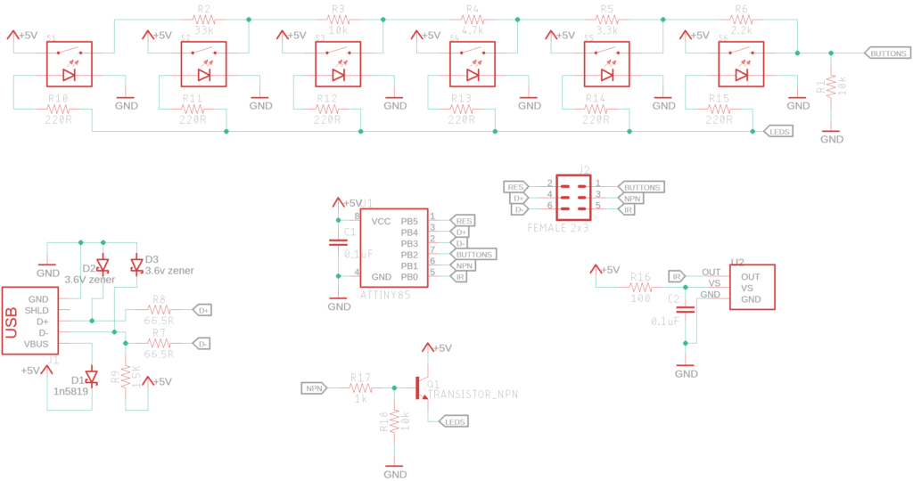
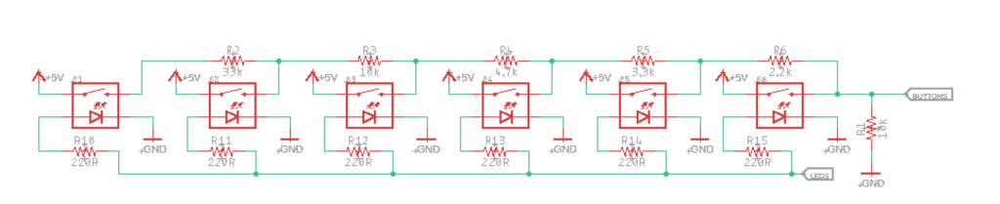

#+title: lazyboard code base

* what is lazyboard
read more detailed in [[https://lezzetlirobottarifleri.com/lazyboard-usengec-ama-uretken-kisiler-icin-kisisellestirilebilir-macropad/#Lazyboardu_ve_Komponentleri_Temin_Etme][lazyboard tutorial (Turkish)]]

* uploading code
#+begin_src sh
pio run -t upload
#+end_src
start the upload first, then plug lazyboard in when micronucleus asks for the device.
see [[./docs/encountred_issues.org][encountered issues]] for more upload problems.

** uploading on windows
on windows, the upload can fail with this popup:
#+begin_example
micronucleus.exe - System Error
The code execution cannot proceed because libusb0.dll was not found.
#+end_example
platformio's =micronucleus.exe= needs =libusb0.dll= and the libusb-win32 driver, which windows doesn't have by default.

1. install the driver: run [[https://zadig.akeo.ie][Zadig]], plug lazyboard in, pick the "Digispark Bootloader" / "Unknown Device" entry,
   choose *libusb-win32* (not WinUSB) and install. the bootloader only shows up for a few seconds, so replug if needed.
2. get the uploader with its dll, one of:
   - download the =micronucleus-win64= artifact from this repo's GitHub Actions ("build windows uploader" workflow) or release assets
   - build it on linux: =./tools/build-micronucleus-win.sh= (needs =mingw-w64=)
3. put =micronucleus.exe= and =libusb0.dll= into =tools/win/=

=scripts/win_uploader.py= (enabled in =platformio.ini=) uses =tools/win/= automatically on windows.
if =libusb0.dll= is missing, the upload stops with a message pointing here instead of the popup.

references:
- [[https://github.com/micronucleus/micronucleus][micronucleus]] (uploader / bootloader, GPL)
- [[https://github.com/mcuee/libusb-win32][libusb-win32]] (=libusb0.dll= and driver, LGPL)
- [[https://zadig.akeo.ie][Zadig]] / [[https://github.com/pbatard/libwdi][libwdi]] (driver installer, GPL)
- [[https://docs.platformio.org/en/latest/boards/atmelavr/digispark-tiny.html][platformio digispark-tiny board]]

* default layout (src/main.cpp)
every button has a *short press* and a *hold* (>= 400ms) action. *hold S6* switches layer;
the led blinks layer+1 times, and the layer is remembered after replug (eeprom).

| button | layer 0 media: short | hold          | layer 1 desktop (windows): short | hold                         |
|--------+----------------------+---------------+----------------------------------+------------------------------|
| S1     | copy (ctrl+c)        | vol- (repeat) | prev virtual desktop (win+ctrl+←) | -                            |
| S2     | prev track           | -             | snip region (win+shift+s)        | screenshot to file (win+prtsc) |
| S3     | play/pause           | mute          | mic mute in calls (win+alt+k)    | lock (win+l)                 |
| S4     | next track           | -             | next virtual desktop (win+ctrl+→) | task view (win+tab)          |
| S5     | paste (ctrl+v)       | vol+ (repeat) | show desktop (win+d)             | clipboard history (win+v)    |
| S6     | esc                  | switch layer  | esc                              | switch layer                 |

- buttons without a hold action fire on press; the others fire on release (short) or after 400ms (hold).
- change shortcuts in the =keymap= table in =src/main.cpp=. for linux terminals set =COPY_MODS= to =(MOD_CONTROL_LEFT | MOD_SHIFT_LEFT)=.
- if buttons misfire, recalibrate with =examples/template_read_analog.ino= and update the =th[]= thresholds (midpoints between button readings).
- =win+alt+k= only works on windows 11 in call apps that support it (teams etc.).
- after flashing a new library version, windows may keep the old usb descriptor: if media keys act wrong, remove the device in device manager and replug.

* libraries that used in code

#+begin_src gitconfig :tangle .gitmodules
[submodule "DigisParkKeyboard"]
	path = lib/DigisParkKeyboard
	url = https://github.com/mal1kc/digisparkkeyboard
	branch = main
#+end_src
- [[https://github.com/mal1kc/digisparkkeyboard][lib/digisparkkeyboard]]
** coding tutorial and template code

*** including library

#+begin_src c :tangle ./examples/template.ino
#define kbd_tr_tr // define keyboard layout
#include "DigiKeyboard.h" // include library file
#+end_src

*** led control

all leds can be controlled via transistor that connected to PB1 port of attiny85, they can't be conntrolled separately.

#+begin_src c :tangle ./examples/template_led_control.ino

// ------ led control ------

#define led 1 // defining pin number

void setup() {
  pinMode(led, OUTPUT); // setting pinmode as output
}

void loop() {
  digitalWrite(led, HIGH); // led on
  delay(500);
  digitalWrite(led, LOW); // led off
  delay(500);
}
#+end_src

*** reading analog values

attiny85 in lazyboard, that has internal uart or usb uart unit cause this reason we can't directly transfer analog data to serial monitor.But there is a trick,
we can intruduce lazyboard as keyboard to pc than we can transfer datas like  printing with keyboard.

#+begin_src c :tangle ./examples/template_read_analog.ino

// ----- reading analog values -----

// setting tr(turkish) keyboard layout
#define kbd_tr_tr
#include "DigiKeyboard.h"

void setup() {
  // disable input for 2,5 second for no startup errors
  // and sending empty keystroke
  DigiKeyboard.delay(2500);
  DigiKeyboard.sendKeyStroke(0);
}

void loop() {

  // reading mechanic switch data and assigning into data variable
  int data = analogRead(1);
  if ( data > 100)
  {
    // writing "read val: " from keyboard
    // WARN: error from library cannot print 'ğ' keyword
    DigiKeyboard.print("read val:    ");
    DigiKeyboard.print(data);
    // sending 'return'/'enter' key stroke
    DigiKeyboard.sendKeyStroke(KEY_ENTER);
    while (analogRead(1) > 100);
  }
  // for ignoring analog read unstabilty to waiting very short time
  DigiKeyboard.delay(50);
}
#+end_src

*** mechanic switch control

like we can see in scheme if we press *S6* 2.2K resistance and under favour of 10K voltage divider data reading accurs. when we press *S5* 3.3K + 2.2K = 5.5K through voltage divider then accourdingly to that it comes to attiny85.in this senario we can understand which key is pressed.
*WARN:we need to calibrate our buttons to work all buttons *
#+begin_src c :tangle ./examples/template_switch_control.ino

// ---- switch control -----

#define kbd_tr_tr
#include "DigiKeyboard.h"

void setup() {
  DigiKeyboard.delay(2500);
  DigiKeyboard.sendKeyStroke(0);
}

void loop() {

  int data = analogRead(1);
  if ( data > 100)
  {
      //if button 6 pressed we do this operations
    if (data > 933) {
      DigiKeyboard.print("button 6 pressed");
    }
      //if button 5 pressed we do this operations
    else if (data > 747) {
      DigiKeyboard.print("button 5 pressed");
    }
      //if button 4 pressed we do this operations
    else if (data > 577) {
      DigiKeyboard.print("button 4 pressed");
    }
      //if button 3 pressed we do this operations
    else if (data > 421) {
      DigiKeyboard.print("button 3 pressed");
    }
      //if button 2 pressed we do this operations
    else if (data > 249) {
      DigiKeyboard.print("button 2 pressed");
    }
      //if button 1 pressed we do this operations
    else  {
      DigiKeyboard.print("button 1 pressed");
    }

    DigiKeyboard.sendKeyStroke(KEY_ENTER);
    while (analogRead(1) > 100);
  }

}
#+end_src

*** Controlling via laser remote control
**** intruducing remote control buttons
with infrared in lazyboard we can use with infrared remote control devices.
but we need to find buttons hex codes to configure buttons, for this we can use this code snippet.
#+begin_src c :tangle ./examples/template_rc_introduce.ino
#define kbd_tr_tr
#include "DigiKeyboard.h"

// setting IR reader pin, 0 is default for 'Lazyboard'
const byte IRpin = 0;

// creating and assinging remote and irCode variables ,there are neccesary for our algorithm
volatile boolean remote = false;
volatile unsigned long irCode = 0;

void setup() {

    // setting IR reader pin's mode as Input
  pinMode(IRpin, INPUT);

  // waiting to 2,5s to initialize and start with empty keystroke
  DigiKeyboard.delay(2500);
  DigiKeyboard.sendKeyStroke(0);
}

void loop() {
    // IR reader gives 1 (HIGH) when it not detect any signal
  if (digitalRead(IRpin)) {
    remoting();
  } else {

      // when it gets signal we print values to our computer as keyboard
    DigiKeyboard.println(irCode, HEX);
  }
  // for our algorith work we change remote as true
  remote = true;
}

//IR reading func
void remoting()
{
  if (remote) {
    remote = false;
    unsigned long T;
    for (byte n = 0; n < 32; n++) {
      do {
        T = pulseIn(IRpin, HIGH, 2200);
      } while (T < 64);
      bitWrite(irCode, n, T > 1120);
    }
  }
}
#+end_src

**** using remote control

#+begin_src c :tangle ./examples/template_rc_buttons.ino
#define kbd_tr_tr
#include "DigiKeyboard.h"

// setting IR reader pin, 0 is default for 'Lazyboard'
const byte IRpin = 0;

// creating and assinging remote and irCode variables ,there are neccesary for our algorithm
volatile boolean remote = false;
volatile unsigned long irCode = 0;

void setup() {

    // setting IR reader pin's mode as Input
  pinMode(IRpin, INPUT);

  // waiting to 2,5s to initialize and start with empty keystroke
  DigiKeyboard.delay(2500);
  DigiKeyboard.sendKeyStroke(0);
}

void loop() {
    // IR reader gives 1 (HIGH) when it not detect any signal
  if (digitalRead(IRpin)) {
    remoting();
  } else {
    // if pressed 1.button
    if (irCode == 0xE718FF00) {
      DigiKeyboard.println("Up");
      irCode = 0;
    }
    // if pressed 2.button
    else if(irCode == 0xAD52FF00)
    {
      DigiKeyboard.println("Down");
      irCode = 0;
    }
  // for our algorith work we change remote as true
  remote = true;
}

//IR reading func
void remoting()
{
  if (remote) {
    remote = false;
    unsigned long T;
    for (byte n = 0; n < 32; n++) {
      do {
        T = pulseIn(IRpin, HIGH, 2200);
      } while (T < 64);
      bitWrite(irCode, n, T > 1120);
    }
  }
}
#+end_src

*** doing key combinations
for some situations you may need press multiple button in same time situations like these we use code in below :

#+begin_src c
DigiKeyboard.sendKeyStroke()
#+end_src

example of copy

#+begin_src c

DigiKeyboard.sendKeyStroke(KEY_C , MOD_CONTROL_LEFT);
// KEY_C is 'C', MOD_CONTROL_LEFT is left control button (left-ctrl)
DigiKeyboard.sendKeyStroke(KEY_V , MOD_CONTROL_LEFT);
// KEY_V is 'V', MOD_CONTROL_LEFT is left control button (left-ctrl)

#+end_src

maybe u need 3 triple key combinations you can use somethink like
#+begin_src c
DigiKeyboard.sendKeyStroke(KEY_S, MOD_GUI_LEFT | MOD_SHIFT_LEFT);
//KEY_S is 'S', MOD_GUI_LEF is left super (prob. key with windows logo) key , MOD_SHIFT_LEFT is left Shift

#+end_src

some special keys

| key_val             | keyboard equivalents  |
|---------------------+-----------------------|
| MOD_CONTROL_LEFT    | left Control key      |
| MOD_SHIFT_LEFT      | left Shift key        |
| MOD_ALT_LEFT        | left Alt key          |
| MOD_GUI_LEFT        | left Super key        |
| +                 + | +                   + |
| MOD_CONTROL_RIGHT   | right Control key     |
| MOD_SHIFT_RIGHT     | right Shift key       |
| MOD_ALT_RIGHT       | right Alt key         |
| MOD_GUI_RIGHT       | right Super key       |

you can use *'KEY_'* as prefix for keys in English like in T => KEY_T
but specific layouts like Turkish you need to use *.print()* funtion
WARN: some apps can be problematic with *.print()* func because of that try using English keys if it is possible

*** adding custom shortcuts for applications

you can use lazyboard as launcher for launch your frequent used apps.
look for example :
#+begin_src c
#define kbd_tr_tr
#include "DigiKeyboard.h"

void setup() {
  // disable input for 2,5 second for no startup errors
  // and sending empty keystroke
  DigiKeyboard.delay(2500);
  DigiKeyboard.sendKeyStroke(0);
}

void loop() {
  int data = analogRead(1);
  if (data > 100) {
   if (data > 933) {
    // open windows run WİN+R
    DigiKeyboard.sendKeyStroke(KEY_R, MOD_GUI_LEFT);
    DigiKeyboard.delay(500);
    // open cmd
    // Win + r + print cmd + enter
    DigiKeyboard.print("cmd");
    DigiKeyboard.sendKeyStroke(KEY_ENTER);
    DigiKeyboard.delay(600);

    // run command to  change dir tor EAGLE dir
    DigiKeyboard.print("cd C:\/");
    DigiKeyboard.print("EAGLE 9.6.2/");
    DigiKeyboard.delay(500);
    DigiKeyboard.sendKeyStroke(KEY_ENTER);

    // run eagle
    DigiKeyboard.print("eagle.exe");
    DigiKeyboard.sendKeyStroke(KEY_ENTER);
    DigiKeyboard.delay(500);

    // close cmd via alt + f4
    DigiKeyboard.sendKeyStroke(KEY_F4, MOD_ALT_LEFT);
  } else if (data > 747) {
    // windows run  win + r
    DigiKeyboard.sendKeyStroke(KEY_R, MOD_GUI_LEFT);
    DigiKeyboard.delay(500);

    // CMD
    DigiKeyboard.print("cmd");
    DigiKeyboard.sendKeyStroke(KEY_ENTER);
    DigiKeyboard.delay(600);
    // cd to arduino installation dir
    DigiKeyboard.print("cd C:\/");
    DigiKeyboard.print("Program Files\/");
    DigiKeyboard.print("Arduino IDE/");
    DigiKeyboard.delay(500);
    DigiKeyboard.sendKeyStroke(KEY_ENTER);
    DigiKeyboard.delay(500);

    // run arduino
    // reason for keystroke 0x35;
    // in some app names have spaces for this situations we use '"' symbol and it s hex code is 0x35. (cmd)

    DigiKeyboard.sendKeyStroke(0x35);
    DigiKeyboard.print("Arduino IDE.exe");
    DigiKeyboard.sendKeyStroke(0x35);
    DigiKeyboard.sendKeyStroke(KEY_ENTER);

    // if we close cmd arduino ide close cause of this reason we not close cmd
    DigiKeyboard.delay(500);
  } else if (data > 577) {
      //if button 4 pressed we do this operations
  } else if (data > 421) {
      //if button 3 pressed we do this operations
  } else if (data > 249) {
      //if button 2 pressed we do this operations
  } else {
      //if button 1 pressed we do this operations
  }

  DigiKeyboard.sendKeyStroke(KEY_ENTER);
  while (analogRead(1) > 100);
 }
}
#+end_src
